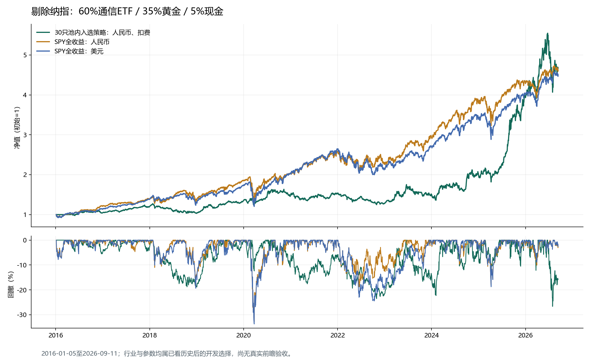

# 剔除纳指后的30只ETF：标普500对标研究验收

日期：2026-09-13。验证运行：`20260913-104621`。

**历史研究验收通过；实盘投资准入未通过。** 入选规则：剔除纳指：60%通信ETF / 35%黄金 / 5%现金。通信ETF（515880）不符合当日资格时，以合格沪深300ETF（510300）承接权益目标；均不合格则现金。黄金ETF为518880。交易、信号和行情均严格排除513100，实际操作3只，均属于剩余30只研究池。

**时期依赖限制：** 2025年策略收益为96.96%；截至2024年底，2016年以来年化仅7.99%，同期人民币SPY为16.00%。最终对标达标高度依赖这段行情，不能据此认定可持续超额收益或实盘准入。数值核对见`output/sp500_ex_nasdaq/verification/period_dependence.json`。

## 对标结果

| 区间（截至2026-09-11） | 对象 | 累计收益 | 年化 | 最大回撤 |
| --- | --- | ---: | ---: | ---: |
| 2021-01-04起 | 策略（扣费） | 207.93% | 21.88% | -26.66% |
| 2021-01-04起 | SPY全收益人民币 | 129.14% | 15.71% | -18.80% |
| 2021-01-04起 | SPY全收益美元 | 123.19% | 15.17% | -24.50% |
| 2021-01-04起 | 标普价格指数美元 | 106.91% | 13.65% | -25.43% |
| 2016-01-05起 | 策略（扣费） | 366.79% | 15.51% | -26.66% |
| 2016-01-05起 | SPY全收益人民币 | 362.69% | 15.42% | -32.78% |
| 2016-01-05起 | SPY全收益美元 | 350.22% | 15.12% | -33.72% |
| 2016-01-05起 | 标普价格指数美元 | 279.68% | 13.30% | -33.92% |

预先固定的收益门槛：年化落后人民币SPY不超过2个百分点，累计收益至少达到其85%；两个起点均以100万元现金重新建仓，扣除交易成本，不使用杠杆或做空。美国收盘只用于事后基准比较，不进入中国当日信号。表中基准回撤采用全部美国交易日；曲线向后对齐中国交易日，汇率与分红口径沿用已核对的冻结快照。



## 固定执行规则

1. 上市观察、20日日均成交额至少5000万元、当时已公告规模至少2亿元、缺价及退市检查保留。通信的资格缺位按预先规定的沪深300代理处理；没有为历史早期补入当时不合格的行业ETF。
2. 每日收盘后按固定权重检查漂移，次一中国交易日开盘执行。再平衡偏差带3个百分点；保留原权重后再次核对风险；资格退出优先。
3. 观察波动，不按预测波动强制缩仓；目标总仓位不超过95%，单只与同组下单上限85%。日双边换手预算30%，买入仅用卖出需求扣除后的剩余额度与实际现金；价格漂移可能使盘后权重偏离目标，下一决策再调整。
4. 买入按100份整数倍；参与率上限为20日日均成交额的2%。佣金单边0.03%，最低0.2元；基础滑点5bp，加参与率冲击；现金不计息。缺价、停牌与价格限制拒绝成交，卖单未成交时不预支现金。
5. 研究回撤预算30%，原投资准入20%线另报。这些历史预算均不保证未来最大亏损。

本方案存在较高的单一通信行业暴露，不能视为对标普500的日常跟踪。长期早期收益部分来自沪深300代理，近年结果依赖通信与黄金的历史行情。原正式策略及默认账户未切换。

## 成交压力

| 情景 | 累计收益 | 年化 | 最大回撤 | 收益达标 |
| --- | ---: | ---: | ---: | --- |
| slippage_2 | 361.98% | 15.40% | -26.66% | 是 |
| slippage_3 | 357.39% | 15.29% | -26.67% | 是 |
| capital_100 | 371.29% | 15.62% | -26.66% | 是 |
| capital_10 | 388.39% | 16.00% | -26.66% | 是 |
| partial_50 | 422.66% | 16.74% | -26.65% | 是 |
| delay_2 | 383.11% | 15.89% | -26.63% | 是 |

6个压力均为正收益且回撤不超过30%：True。每个情景的收益是否仍接近标普已单列，不将“压力下仍盈利”写成“压力下均达到收益门槛”。资本、整数份额和调仓路径会使摩擦与最终收益不呈严格单调关系。

## 权重邻域与附加检查

通信50%/55%/60%/65%/70%，黄金补足95%总目标；4/5组同时满足长期收益目标与30%回撤预算，预登记门槛为至少2/3。主候选事前固定为60%，没有选择收益最大的权重点。

| 情景 | 累计收益 | 年化 | 最大回撤 | 收益达标 |
| --- | ---: | ---: | ---: | --- |
| communication50 | 346.78% | 15.04% | -23.15% | 是 |
| communication55 | 356.67% | 15.28% | -24.91% | 是 |
| communication60 | 366.79% | 15.51% | -26.66% | 是 |
| communication65 | 374.15% | 15.68% | -28.46% | 是 |
| communication70 | 379.57% | 15.81% | -30.17% | 是 |

| 情景 | 累计收益 | 年化 | 最大回撤 | 收益达标 |
| --- | ---: | ---: | ---: | --- |
| band_002 | 369.11% | 15.57% | -26.80% | 是 |
| band_005 | 363.21% | 15.43% | -26.89% | 是 |
| commission_min5 | 366.40% | 15.50% | -26.66% | 是 |
| active_vol20 | 279.44% | 13.30% | -23.65% | 否 |
| active_vol25 | 326.84% | 14.55% | -23.54% | 是 |

2016–2020分段诊断：年化8.46%，最大回撤-18.87%。该段和滚动窗口都属于已看历史，不是新的独立样本外确认。

## 年度表现与统计限制

| 年度（2026截至9月11日） | 策略 | SPY全收益人民币 |
| --- | ---: | ---: |
| 2016 | 4.41% | 20.69% |
| 2017 | 14.73% | 14.46% |
| 2018 | -13.32% | 0.48% |
| 2019 | 30.32% | 33.29% |
| 2020 | 10.80% | 10.48% |
| 2021 | 2.58% | 25.77% |
| 2022 | -16.75% | -10.59% |
| 2023 | 18.51% | 28.78% |
| 2024 | 31.50% | 28.24% |
| 2025 | 96.96% | 12.85% |
| 2026 | 18.76% | 8.00% |

最差滚动252交易日收益差为-56.72%，最好为142.64%；月收益相关系数0.235。日均超额收益21日块bootstrap的95%区间为[-0.05%, 0.05%]，未经多重选择调整，不能据此声称显著alpha。

本轮8批、95个登记配置回放（含重复对照），并保留此前31只池的34个已查看候选。通信来自全行业历史筛选，权重邻域通过不能消除行业选择偏差。当前存续池仍缺完整历史目录与公司行动审计，真实前瞻0/126日，投资准入不成立。

## 工程证据与重放

- 两个起点的独立验证净值差额：{'long': 0.0, 'recent': 0.0}元；全部完整情景完成逐日现金/份额账本核对，信号早于成交、买入资格、整手和参与率检查。
- 所有成交属于30只池：True；生产指针保持不变：True；基础两个区间均满足原20%回撤线：False。
- 本轮相关工程检查见`output/sp500_ex_nasdaq/verification/unittest.txt`，最终重放、哈希与产物验收以`output/sp500_ex_nasdaq/completion_verification.json`为准。

```powershell
.venv\Scripts\python.exe -m research.ex_nasdaq.replay
.venv\Scripts\python.exe -m research.ex_nasdaq.validate --protocol research/ex_nasdaq/validation_protocol.json
```

规则：[selected_strategy.json](../research/ex_nasdaq/selected_strategy.json)。验证：[results.json](../output/sp500_ex_nasdaq/validation/20260913-104621/results.json)。研究计划：[SP500_EX_NASDAQ_PLAN.md](SP500_EX_NASDAQ_PLAN.md)。

## 全部候选（包含失败结果）

| 批次 | 候选 | 长期年化 | 长期回撤 | 近期年化 | 双区间收益达标 |
| --- | --- | ---: | ---: | ---: | --- |
| 20260913-100746 | gold85_control | 10.69% | -26.02% | 13.73% | 否 |
| 20260913-100746 | gold60_dividend35 | 8.75% | -21.01% | 12.88% | 否 |
| 20260913-100746 | gold50_broad45 | 8.14% | -19.49% | 8.38% | 否 |
| 20260913-100746 | momentum_20_k1 | 7.64% | -52.57% | 1.33% | 否 |
| 20260913-100746 | momentum_20_k2 | 4.96% | -58.21% | 0.11% | 否 |
| 20260913-100746 | momentum_20_k3 | 8.85% | -45.97% | 6.01% | 否 |
| 20260913-100746 | momentum_60_k1 | 10.24% | -35.54% | 10.84% | 否 |
| 20260913-100746 | risk_momentum_20_k1 | 0.88% | -52.75% | 0.00% | 否 |
| 20260913-100746 | momentum_60_k3 | 8.17% | -41.51% | 1.99% | 否 |
| 20260913-100746 | risk_momentum_20_k3 | 6.65% | -38.27% | 1.27% | 否 |
| 20260913-100746 | risk_momentum_60_k2 | 11.11% | -30.46% | 11.58% | 否 |
| 20260913-100746 | gold50_domestic_momentum | 10.37% | -20.62% | 9.19% | 否 |
| 20260913-100746 | gold50_domestic_risk_momentum | 10.98% | -19.55% | 9.34% | 否 |
| 20260913-101226 | regression60_k1_D | -3.53% | -70.00% | -11.60% | 否 |
| 20260913-101226 | regression20_k1_D | -2.27% | -65.40% | -0.10% | 否 |
| 20260913-101226 | regression20_k3_D | 1.67% | -36.43% | 3.91% | 否 |
| 20260913-101226 | regression20_k1_W-FRI | -1.70% | -46.59% | -0.89% | 否 |
| 20260913-101226 | regression60_k1_W-FRI | -2.69% | -64.84% | -12.11% | 否 |
| 20260913-101226 | regression60_k3_D | 5.06% | -34.50% | -1.47% | 否 |
| 20260913-101226 | momentum20_k1_daily | -8.57% | -68.08% | -11.17% | 否 |
| 20260913-101226 | momentum60_k1_daily | -6.29% | -73.78% | -10.51% | 否 |
| 20260913-101226 | momentum20_k3_daily | -2.15% | -48.06% | -2.42% | 否 |
| 20260913-101226 | risk_long_k2_weekly | 11.43% | -31.95% | 11.89% | 否 |
| 20260913-101226 | momentum60_k3_daily | -2.69% | -50.33% | -7.88% | 否 |
| 20260913-101226 | gold40_regression20_k2_daily | 5.74% | -20.12% | 8.12% | 否 |
| 20260913-101226 | regression20_k1_daily_vol20 | -0.81% | -58.81% | 1.88% | 否 |
| 20260913-101226 | momentum20_k1_daily_vol20 | -5.79% | -57.33% | -7.14% | 否 |
| 20260913-101716 | macro_momentum60_k1 | 1.15% | -37.33% | -5.74% | 否 |
| 20260913-101716 | macro_momentum20_k1 | 2.67% | -42.32% | -2.58% | 否 |
| 20260913-101716 | macro_momentum60_k2 | 6.79% | -20.51% | 4.41% | 否 |
| 20260913-101716 | macro_risk_momentum20_k1 | 1.49% | -35.78% | -1.90% | 否 |
| 20260913-101716 | macro_risk_momentum60_k1 | 7.62% | -22.25% | 6.33% | 否 |
| 20260913-101716 | macro_risk_momentum20_k2 | 4.36% | -24.51% | 1.33% | 否 |
| 20260913-101716 | macro_risk_momentum60_k2 | 7.00% | -21.54% | 4.09% | 否 |
| 20260913-101716 | macro_regression60_W-FRI | 3.78% | -38.82% | -3.63% | 否 |
| 20260913-101716 | macro_regression20_D | -1.14% | -36.26% | 2.39% | 否 |
| 20260913-101716 | macro_regression120_M | 2.09% | -27.18% | -0.53% | 否 |
| 20260913-101716 | all_risk_long_k2_vol0.15 | 8.59% | -18.68% | 8.61% | 否 |
| 20260913-101716 | all_risk_long_k2_vol0.2 | 10.45% | -20.47% | 10.55% | 否 |
| 20260913-101716 | all_risk_long_k2_vol0.25 | 11.06% | -21.99% | 11.42% | 否 |
| 20260913-101716 | macro_risk_long_k2_vol0.15 | 7.34% | -18.54% | 5.08% | 否 |
| 20260913-101716 | macro_risk_long_k2_vol0.2 | 7.35% | -20.30% | 4.71% | 否 |
| 20260913-101716 | macro_risk_long_k2_vol0.25 | 7.04% | -21.54% | 4.20% | 否 |
| 20260913-102207 | pullback5_trend120_k3 | -4.95% | -45.55% | -7.12% | 否 |
| 20260913-102207 | pullback5_trend240_k3 | -2.54% | -31.05% | -3.96% | 否 |
| 20260913-102207 | pullback5_trend120_k5 | -3.30% | -33.48% | -5.07% | 否 |
| 20260913-102207 | pullback20_trend120_k3 | -4.11% | -43.17% | -7.74% | 否 |
| 20260913-102207 | pullback20_trend240_k3 | -3.98% | -45.97% | -8.64% | 否 |
| 20260913-102207 | pullback5_trend240_k5 | -0.98% | -28.05% | -2.54% | 否 |
| 20260913-102207 | gold40_pullback5_trend120 | 1.90% | -20.81% | 0.91% | 否 |
| 20260913-102207 | gold40_pullback20_trend120 | 2.01% | -22.43% | 0.44% | 否 |
| 20260913-102207 | pullback5_trend120_k3_daily | -4.46% | -41.48% | -5.94% | 否 |
| 20260913-102207 | pullback5_trend120_k3_no_vol | -6.05% | -51.55% | -9.09% | 否 |
| 20260913-102711-003315 | risklong_trend60_M | 5.68% | -36.07% | 6.82% | 否 |
| 20260913-102711-003315 | risklong_trend60_W-FRI | 6.30% | -25.45% | 6.54% | 否 |
| 20260913-102711-003315 | risklong_trend120_M | 5.47% | -31.75% | 5.30% | 否 |
| 20260913-102711-003315 | risklong_trend120_W-FRI | 7.38% | -27.07% | 6.18% | 否 |
| 20260913-102711-003315 | risklong_trend200_M | 10.78% | -23.46% | 12.49% | 否 |
| 20260913-102711-003315 | risklong_trend200_W-FRI | 11.35% | -20.30% | 12.28% | 否 |
| 20260913-102711-003315 | risklong_trend120_k1 | 5.71% | -38.64% | 5.15% | 否 |
| 20260913-102711-003315 | risklong_trend120_k3 | 7.39% | -26.40% | 6.59% | 否 |
| 20260913-102739-e587d405 | ridge_k3_M | 3.58% | -23.32% | 3.23% | 否 |
| 20260913-102739-e587d405 | ridge_k5_M | 1.96% | -39.68% | -0.65% | 否 |
| 20260913-102739-e587d405 | ridge_k3_W-FRI | 3.33% | -20.34% | 1.55% | 否 |
| 20260913-102739-e587d405 | gold40_ridge_k3 | 5.79% | -21.42% | 4.60% | 否 |
| 20260913-102739-e587d405 | lightgbm_k3_M | 7.52% | -27.38% | 10.39% | 否 |
| 20260913-102739-e587d405 | lightgbm_k5_M | 6.76% | -26.13% | 9.39% | 否 |
| 20260913-102739-e587d405 | lightgbm_k3_W-FRI | 3.04% | -24.70% | 4.64% | 否 |
| 20260913-102739-e587d405 | gold40_lightgbm_k3 | 10.61% | -21.41% | 14.95% | 否 |
| 20260913-103115-280dcbbc | industry_159915_gold30 | 8.04% | -35.56% | 7.63% | 否 |
| 20260913-103115-280dcbbc | industry_588000_gold30 | 8.68% | -39.08% | 6.47% | 否 |
| 20260913-103115-280dcbbc | industry_512880_gold30 | 6.67% | -30.35% | 3.76% | 否 |
| 20260913-103115-280dcbbc | industry_512800_gold30 | 8.00% | -23.78% | 10.03% | 否 |
| 20260913-103115-280dcbbc | industry_512010_gold30 | 4.09% | -42.13% | -3.13% | 否 |
| 20260913-103115-280dcbbc | industry_512170_gold30 | 2.44% | -48.02% | -4.11% | 否 |
| 20260913-103115-280dcbbc | industry_159928_gold30 | 5.95% | -31.80% | -3.32% | 否 |
| 20260913-103115-280dcbbc | industry_512690_gold30 | 5.05% | -32.47% | -4.94% | 否 |
| 20260913-103115-280dcbbc | industry_159996_gold30 | 8.38% | -23.63% | 5.87% | 否 |
| 20260913-103115-280dcbbc | industry_159995_gold30 | 12.89% | -40.20% | 14.45% | 否 |
| 20260913-103115-280dcbbc | industry_512720_gold30 | 6.66% | -33.49% | 3.48% | 否 |
| 20260913-103115-280dcbbc | industry_515070_gold30 | 9.64% | -33.73% | 8.24% | 否 |
| 20260913-103115-280dcbbc | industry_512980_gold30 | 6.13% | -34.57% | 3.64% | 否 |
| 20260913-103115-280dcbbc | industry_515880_gold30 | 15.68% | -28.46% | 22.19% | 是 |
| 20260913-103115-280dcbbc | industry_512660_gold30 | 8.48% | -29.93% | 4.02% | 否 |
| 20260913-103115-280dcbbc | industry_515790_gold30 | 3.35% | -42.91% | -3.22% | 否 |
| 20260913-103115-280dcbbc | industry_515030_gold30 | 8.45% | -43.16% | 5.87% | 否 |
| 20260913-103115-280dcbbc | industry_512400_gold30 | 12.44% | -33.10% | 12.19% | 否 |
| 20260913-103115-280dcbbc | industry_515220_gold30 | 13.13% | -21.81% | 14.69% | 否 |
| 20260913-103115-280dcbbc | industry_512200_gold30 | 2.59% | -33.92% | -1.45% | 否 |
| 20260913-103115-280dcbbc | industry_512580_gold30 | 7.68% | -26.24% | 4.65% | 否 |
| 20260913-103726-e3743ca2 | communication50_gold45 | 15.04% | -23.15% | 20.91% | 是 |
| 20260913-103726-e3743ca2 | communication60_gold35 | 15.51% | -26.66% | 21.88% | 是 |
| 20260913-103726-e3743ca2 | communication55_gold40 | 15.28% | -24.91% | 21.35% | 是 |
| 20260913-103726-e3743ca2 | communication65_gold30 | 15.68% | -28.46% | 22.19% | 是 |
| 20260913-103726-e3743ca2 | communication70_gold25 | 15.81% | -30.17% | 22.54% | 是 |
