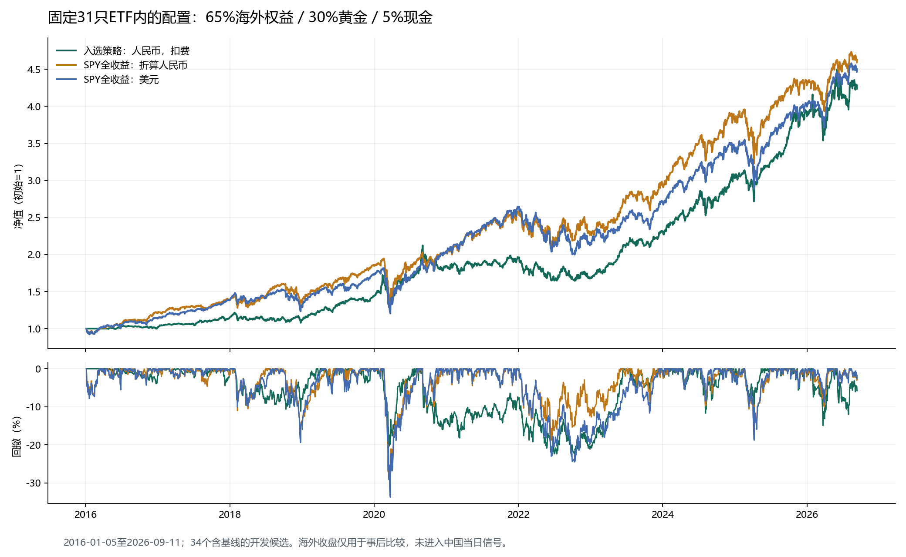

# 31只ETF对标标普500：探索与验收

日期：2026-09-13。最终验证：`20260913-090253`。

**历史探索验收：通过。** 固定65%纳指ETF（513100）、30%黄金ETF（518880）、至少5%现金；纳指不符合当日资格时，用合格恒生ETF（159920）承接海外权益目标，否则留现金。实际使用固定31只池内的这3只ETF。

2016年以来累计323.81%、年化14.47%，同期人民币SPY全收益为362.69%、15.42%；2021重新建仓年化15.81%，同期基准15.71%。这是已查看历史上的开发策略，投资准入仍未通过。

## 同口径比较

| 区间 | 对象 | 累计收益 | CAGR | 最大回撤 |
| --- | --- | ---: | ---: | ---: |
| 2016-01-05—2026-09-11 | 策略：人民币、扣费 | 323.81% | 14.47% | -22.36% |
| 2016-01-05—2026-09-11 | SPY全收益：人民币 | 362.69% | 15.42% | -32.78% |
| 2016-01-05—2026-09-11 | SPY全收益：美元 | 350.22% | 15.12% | -33.72% |
| 2016-01-05—2026-09-11 | 标普价格指数：美元 | 279.68% | 13.30% | -33.92% |
| 2021-01-04—2026-09-11（重新建仓） | 策略：人民币、扣费 | 130.26% | 15.81% | -16.97% |
| 2021-01-04—2026-09-11（重新建仓） | SPY全收益：人民币 | 129.14% | 15.71% | -18.80% |
| 2021-01-04—2026-09-11（重新建仓） | SPY全收益：美元 | 123.19% | 15.17% | -24.50% |
| 2021-01-04—2026-09-11（重新建仓） | 标普价格指数：美元 | 106.91% | 13.65% | -25.43% |

首次测试前定义“接近”：年化落后不超过2个百分点，累计收益至少为人民币SPY全收益的85%。策略资本100万元、扣除交易费用；SPY调整收盘包括分红再投资与基金内部费用，未扣个人税费。美元、人民币和不含分红的价格指数分别列示，没有用较低的价格收益替代全收益目标。

长区间从原始数据首日后的2016-01-05开始，两方起止日期一致，CAGR按实际年份计算。表中标普回撤使用全部美国交易日；曲线按中国报告日向后匹配，最多允许7个自然日报价空档。跨市场同日收盘时刻不同，美国收盘未用于中国当日信号。

基准原始响应、46次SPY分红、USD/CNY和来源时间戳已冻结；腾讯640日标普价格交叉误差小于0.000005%，现金分红递推与调整收盘累计收益差约0.087%。行情截至2026-09-11。



## 可执行规则

1. 保留上市观察期、20日日均成交额至少5,000万元、当时已公告规模至少2亿元及退市/缺价检查；未回填最新规模。纳指资格不足时，才使用预先指定的恒生ETF代理，否则现金。
2. 每个中国交易日正式收盘后按65%海外权益、30%黄金目标生成次日开盘订单。偏离不到3个百分点可保持原权重，随后再检查风险约束。退出中的标的不重新买回；部分成交按真实现金和份额继续处理。
3. 观察波动率，不根据波动预测强制缩仓；目标总仓位最多95%，单只与同组下单上限85%，不做空、不加杠杆。价格变化可导致事后漂移，后续决策再调整。30%是本轮研究的历史回撤验收预算，原20%投资准入线继续单列；两者均非未来回撤保证。
4. 日双边换手预算30%，买入只使用卖出需求扣除后的剩余额度及现有现金，不预支未完成卖单。实际开盘再检查现金、集中度和容量；参与率最多为20日均成交额的2%，买入按100份整数倍，停牌/缺价或价格限制时拒绝成交。
5. 佣金单边0.03%、最低0.2元，基础滑点5bp，另加参与率冲击；现金不计息，另测最低5元佣金。QDII使用场内实际价格，包含汇率与溢价变化，没有拿境外指数替代成交价。

收益主要来自海外成长与黄金配置，不代表逐日跟踪标普500。原生产系统排除QDII、单只上限20%、目标波动15%，与本研究风险预算有明显差异；其投资门禁未修改。本方案也没有依赖尚未补齐资料的实时溢价过滤。

## 成本与执行压力

| 名称 | 累计收益 | CAGR | 最大回撤 | 接近同期人民币SPY |
| --- | ---: | ---: | ---: | --- |
| slippage_2 | 317.31% | 14.31% | -22.59% | 是 |
| slippage_3 | 308.06% | 14.07% | -22.92% | 否 |
| capital_10 | 292.22% | 13.65% | -20.66% | 否 |
| capital_100 | 330.53% | 14.64% | -18.70% | 是 |
| partial_50 | 253.37% | 12.54% | -25.07% | 否 |
| delay_2 | 286.56% | 13.49% | -20.87% | 否 |

6个情景是否均为正收益且回撤不超过30%：**是**；是否都在原20%线内：**否**。表中完整显示收益接近能否维持，部分情景会明显落后基准。容量结论基于日线参与率及冲击模型，不等于开盘盘口实测。

整数份额、现金余量和调仓边界会让费用改变后续交易路径，因此各压力结果不是仅在同一净值曲线上扣一个固定费率，费用或资本与最终收益不必严格单调。

## 权重邻域与附加检查

海外权益55%/60%/65%/70%/75%，黄金补足95%总目标，保留5%现金。5/5组同时满足收益接近及30%研究回撤要求，预定门槛为至少2/3通过。

| 名称 | 累计收益 | CAGR | 最大回撤 | 接近同期人民币SPY |
| --- | ---: | ---: | ---: | --- |
| nas55%_gold40% | 309.43% | 14.10% | -21.30% | 是 |
| nas60%_gold35% | 312.40% | 14.18% | -22.14% | 是 |
| nas65%_gold30% | 323.81% | 14.47% | -22.36% | 是 |
| nas70%_gold25% | 324.39% | 14.49% | -24.12% | 是 |
| nas75%_gold20% | 326.15% | 14.53% | -25.05% | 是 |

| 名称 | 累计收益 | CAGR | 最大回撤 | 接近同期人民币SPY |
| --- | ---: | ---: | ---: | --- |
| active_vol20 | 288.80% | 13.55% | -20.77% | 否 |
| active_vol25 | 313.56% | 14.21% | -21.47% | 是 |
| active_vol30 | 326.43% | 14.54% | -22.36% | 是 |
| band_0.02 | 319.18% | 14.36% | -22.67% | 是 |
| band_0.05 | 315.29% | 14.26% | -23.12% | 是 |
| commission_min_5 | 320.90% | 14.40% | -22.45% | 是 |
| split_ratio_5.0 | 320.63% | 14.39% | -22.41% | 是 |
| restart_2021 | 130.26% | 15.81% | -16.97% | 是 |
| sample_2016_2020 | 84.60% | 13.08% | -20.27% | 否 |

重新开启波动择时与观察模式分别列示，不把不同风险预算下的变化全部归于选股能力。`split_ratio_5.0`将纳指2022-01-14的5.0019因子按新浪份额资料5.0重放，检验舍入差异；不能替代发行人的折算原始凭证。2016–2020为额外环境诊断，仍是已查看历史，不是新盲测。

## 年度与不利证据

| 年度 | 策略 | SPY全收益折算人民币 |
| --- | ---: | ---: |
| 2016 | 1.93% | 20.69% |
| 2017 | 12.08% | 14.46% |
| 2018 | -1.99% | 0.48% |
| 2019 | 28.26% | 33.29% |
| 2020 | 28.54% | 10.48% |
| 2021 | 5.94% | 25.77% |
| 2022 | -13.95% | -10.59% |
| 2023 | 37.50% | 28.78% |
| 2024 | 30.85% | 28.24% |
| 2025 | 27.70% | 12.85% |
| 2026（截至9/11） | 9.60% | 8.00% |

滚动252交易日收益差最差-36.81%，最好37.92%；并非每年、每个窗口都能接近。月收益相关系数0.654。日收盘异步会影响日相关性，不能把低日相关直接解释为独立收益来源。

相对人民币SPY的日均超额收益21日块bootstrap（1,000次）95%区间为[-0.03%, 0.02%]。收益接近不等于显著战胜标普；固定现存31只池与34个含基线候选的选择均存在偏差。

## 工程验收与重放

- 冻结候选独立复跑净值最大差额0.00000000元。每个完整情景逐日检查现金与复权单位账本、信号早于成交、买入资格、整数份额和参与率。
- 86项测试通过，包括新增9项汇率/时间对齐、缺口拒绝、未来价格隔离、并列组、资格替代、分批建仓和风险模式检查。
- 原生产指针和代码指纹保持一致；独立保存研究结果，没有修改默认账户、自动下单或提交Git。最终核验记录在 `output/sp500_exploration/completion_verification.json`。

```powershell
# 校验冻结输入和规则后重放入选策略
.venv\Scripts\python.exe -m research.sp500.replay

# 重做完整验证
.venv\Scripts\python.exe -m research.sp500.validate --protocol research/sp500/validation_protocol_v3.json
```

规则：[selected_strategy.json](../research/sp500/selected_strategy.json)。完整结果：[results.json](../output/sp500_exploration/validation/20260913-090253/results.json)。计划：[中文实施记录](SP500_STRATEGY_EXPLORATION_PLAN.md)。

## 全部开发候选

均截至2026-09-11。不同起始区间明确列示，不跨区间直接排名；失败结果与前两轮未完成稳健性验收的记录均保留。

| 候选 | 起始日 | 累计收益 | CAGR | 最大回撤 | 接近同期人民币SPY |
| --- | --- | ---: | ---: | ---: | --- |
| existing_v211 | 2021-01-04 | 55.32% | 8.05% | -10.64% | 否 |
| global_balanced | 2021-01-04 | 77.56% | 10.63% | -13.38% | 否 |
| global_growth | 2021-01-04 | 97.26% | 12.70% | -15.28% | 否 |
| global_growth_gold | 2021-01-04 | 98.17% | 12.79% | -16.37% | 否 |
| global_china_rotation | 2021-01-04 | 91.91% | 12.15% | -21.28% | 否 |
| global_china_model | 2021-01-04 | 100.33% | 13.00% | -11.99% | 否 |
| dual_momentum_3 | 2021-01-04 | 30.95% | 4.86% | -37.10% | 否 |
| dual_momentum_5 | 2021-01-04 | 23.53% | 3.79% | -33.90% | 否 |
| long_momentum_3 | 2021-01-04 | 24.74% | 3.97% | -33.32% | 否 |
| risk_momentum_3 | 2021-01-04 | 36.55% | 5.63% | -30.33% | 否 |
| risk_momentum_5 | 2021-01-04 | 32.62% | 5.09% | -30.55% | 否 |
| china_model_growth | 2021-01-04 | 91.35% | 12.09% | -11.03% | 否 |
| growth60_gold35 | 2021-01-04 | 123.20% | 15.17% | -15.97% | 是 |
| growth55_gold35_bond5 | 2021-01-04 | 118.17% | 14.71% | -15.15% | 是 |
| growth60_gold25_bond10 | 2021-01-04 | 111.41% | 14.08% | -15.80% | 是 |
| growth50_gold35_bond10 | 2021-01-04 | 115.31% | 14.45% | -14.04% | 是 |
| growth50_gold35_model10 | 2021-01-04 | 121.44% | 15.01% | -14.35% | 是 |
| growth50_gold25_model20 | 2021-01-04 | 117.19% | 14.62% | -14.73% | 是 |
| growth40_gold30_model25 | 2021-01-04 | 115.35% | 14.45% | -12.44% | 是 |
| growth55_gold25_midcap15 | 2021-01-04 | 106.04% | 13.56% | -16.81% | 否 |
| fallback_hangseng | 2016-01-05 | 264.32% | 12.86% | -19.89% | 否 |
| fallback_csi300 | 2016-01-05 | 257.66% | 12.67% | -20.42% | 否 |
| fallback_split | 2016-01-05 | 259.95% | 12.74% | -20.14% | 否 |
| global65_gold30 | 2016-01-05 | 313.56% | 14.21% | -21.47% | 是 |
| global70_gold25 | 2016-01-05 | 309.93% | 14.12% | -22.39% | 是 |
| global75_gold20 | 2016-01-05 | 305.64% | 14.01% | -24.02% | 否 |
| global80_gold15 | 2016-01-05 | 305.63% | 14.01% | -24.53% | 否 |
| monthly_window5 | 2016-01-05 | 281.86% | 13.36% | -21.38% | 否 |
| monthly_window3 | 2016-01-05 | 252.06% | 12.50% | -21.34% | 否 |
| quarterly_window5 | 2016-01-05 | 276.72% | 13.22% | -21.56% | 否 |
| weekly_window2 | 2016-01-05 | 283.08% | 13.40% | -20.92% | 否 |
| fixed_risk_vol30 | 2016-01-05 | 326.43% | 14.54% | -22.36% | 是 |
| fixed_risk_vol40 | 2016-01-05 | 323.81% | 14.47% | -22.36% | 是 |
| fixed_risk_observe | 2016-01-05 | 323.81% | 14.47% | -22.36% | 是 |

**投资准入未通过。** 仍缺完整历史资料审计和126日真实前瞻；更高权益配置可能超过旧20%回撤线。历史目标达成不能替代新规则的前瞻账户和成交验证。
